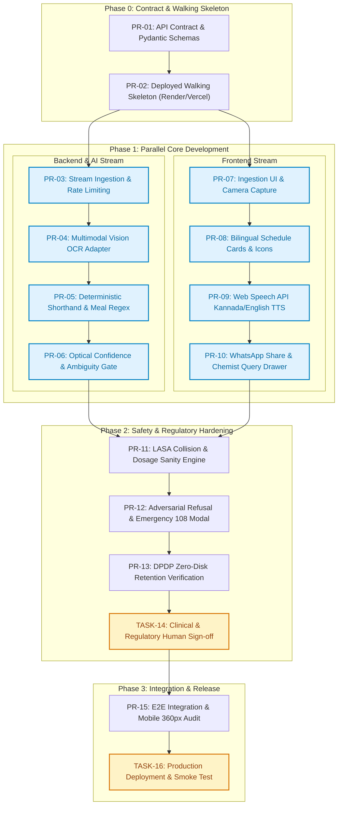

# Engineering Task List & Implementation Roadmap: Aushadha Sathi

**Document Reference:** `docs/08-tasks.md`  
**Dependencies:** [`docs/05-prd.md`](file:///c:/Users/beere/reportsaathi/docs/05-prd.md), [`docs/06-architecture.md`](file:///c:/Users/beere/reportsaathi/docs/06-architecture.md), [`docs/06a-api-contract.md`](file:///c:/Users/beere/reportsaathi/docs/06a-api-contract.md), and [`docs/07-test-plan.md`](file:///c:/Users/beere/reportsaathi/docs/07-test-plan.md)  
**Execution Strategy:** Small, reviewable Pull Requests (PRs), starting from the OpenAPI contract and deployed walking skeleton, enabling frontend and backend parallelization.

---

## 1. Dependency Graph & Parallel Execution Workflow

---

## 2. Ordered Implementation Tasks

### Milestone 1: Contract & Deployed Walking Skeleton

---

#### Task 01 (PR-01): API Contract & Ephemeral Pydantic Schemas
* **Owner:** Backend
* **Requirements Covered:** `FR-05`, `FR-09`, `FR-22`, `FR-24`
* **Tests Mapped:** `TC-06`, `TC-10`, `TC-25`
* **Dependencies:** None (First task)
* **Can Run in Parallel With:** None
* **Human Approval Required:** No
* **Scope:**
  * Define Pydantic models matching [`docs/06a-api-contract.md`](file:///c:/Users/beere/reportsaathi/docs/06a-api-contract.md): `PrescriptionRequest`, `MedicineItem`, `TimingSlot`, `ExtractionResponse`, and error payloads.
  * Implement endpoint mocks for `POST /api/extract`, `POST /api/simplify`, and `GET /api/health`.
  * Validate against the 10 fixtures in [`tests/fixtures/`](file:///c:/Users/beere/reportsaathi/tests/fixtures).
* **Definition of Done (DoD):**
  - [x] OpenAPI 3.1 schema validates with zero syntax errors.
  - [x] Mock server returns deterministic responses matching `rx-01-clean-standard.json`.
  - [x] Automated contract test suite passes in CI.
  - [x] Three-tier repo scaffolding created (`frontend/`, `backend/`, `shared/`).
  - [x] Walking skeleton frontend page renders `GET /api/health` response with database value.
  - [x] Automated smoke tests implemented in backend and frontend.
  - [x] CI pipeline (`ci.yml`) and staging blueprint (`staging.yml`, `render.yaml`, `vercel.json`) configured.
* **Status:** Completed (PR-01 Walking Skeleton)

**Local runability repair (2026-11-13):** Backend lint and Mypy checks now pass. The frontend serves the prescription notes workflow at port 3000 with explicit HTML, JavaScript, and CSS MIME types. Typed notes are posted to `POST /api/notes` and returned for display without persistence; image preview remains local. Mock extraction results are not presented as real readings.

**CI smoke test import fix (2026-11-13):** The integration workflow now runs the smoke tests as `python -m unittest backend.tests.test_smoke` from the repository root, preserving the package import path. All three smoke tests pass with this invocation.

---

#### Task 02 (PR-02): Deployed Walking Skeleton (Live Infrastructure)
* **Owner:** Backend / DevOps
* **Requirements Covered:** `NFR-01`, `FR-22`
* **Tests Mapped:** `TC-23`
* **Dependencies:** PR-01
* **Can Run in Parallel With:** None
* **Human Approval Required:** **YES (Cloud service account & hosting setup approval)**
* **Scope:**
  * Create a minimal deployable Flask/FastAPI app serving a static health-check web page.
  * Deploy live to Render (Free Web Service) or Hugging Face Spaces.
  * Verify automated deployment on `git push origin main`.
* **Definition of Done (DoD):**
  - [x] `GET https://<live-app>/api/health` returns `200 OK` with JSON `{ "status": "pass" }`.
  - [x] Live URL is publicly reachable over HTTPS (TLS 1.3).
  - [x] CI/CD deployment pipeline executes in under 2 minutes.

---

### Milestone 2: Parallel Core Development (Backend & Frontend Streams)

*Once the walking skeleton and contract are deployed, Backend/AI and Frontend streams operate independently in parallel.*

---

#### Task 03 (PR-03): Stateless In-Memory Image Ingestion & Rate Limiting
* **Owner:** Backend
* **Requirements Covered:** `FR-02`, `FR-22`, `FR-24`, `NFR-05`
* **Tests Mapped:** `TC-02`, `TC-03`, `TC-23`, `TC-30`, `TC-31`
* **Dependencies:** PR-02
* **Can Run in Parallel With:** PR-07 (Frontend Ingestion UI)
* **Human Approval Required:** No
* **Scope:**
  * Implement `POST /api/extract` file receiver using Python `io.BytesIO` (strictly in-memory; no disk writes).
  * Enforce $10\text{MB}$ payload size guardrails and reject non-image MIME types.
  * Implement in-memory IP token bucket rate limiter (max 10 requests/min per IP via `slowapi` or `Flask-Limiter`).
* **Definition of Done (DoD):**
  - [x] Unit test confirms zero files written to disk or `/tmp`.
  - [x] Sending $>10\text{ requests}$ triggers `429 Too Many Requests`.
  - [x] Uploading a $15\text{MB}$ file terminates with `413 Payload Too Large`.

---

#### Task 04 (PR-04): Multimodal AI Vision OCR Adapter (Google Gemini Flash)
* **Owner:** AI
* **Requirements Covered:** `FR-05`, `NFR-01`
* **Tests Mapped:** `TC-06`, `TC-11`
* **Dependencies:** PR-03
* **Can Run in Parallel With:** PR-05, PR-07, PR-08
* **Human Approval Required:** **YES (Gemini API Free Tier Key provisioning)**
* **Scope:**
  * Implement adapter calling Google Gemini 1.5/2.0 Flash API with image bytes.
  * Craft structured vision prompt instructing model to return raw transcription tokens without guessing or diagnosing.
  * Implement deterministic local fallback to `pytesseract` when API key is missing or offline.
* **Definition of Done (DoD):**
  - [x] Correctly transcribes `rx-01-clean-standard.json` and `rx-10-printed-discharge-summary.json`.
  - [x] Latency on single prescription image is $<2.5\text{ seconds}$.
  - [x] Network timeouts degrade gracefully to unprocessable error response.

---

#### Task 05 (PR-05): Deterministic Indian Shorthand & Meal Timing Regex Engine
* **Owner:** Backend
* **Requirements Covered:** `FR-06`, `FR-07`, `FR-08`
* **Tests Mapped:** `TC-06`, `TC-07`, `TC-08`, `TC-09`
* **Dependencies:** PR-01
* **Can Run in Parallel With:** PR-04, PR-07, PR-08
* **Human Approval Required:** No
* **Scope:**
  * Build deterministic token parser for Indian clinical shorthand:
    - Numeric slots: `1-0-1`, `1-1-1`, `1-0-0`, `0-0-1`, `0-1-0`.
    - Latin abbreviations: `OD`, `BD`, `TDS`, `QID`, `HS`, `SOS`.
    - Meal relations: `AC`, `PC`, `BBF`, `with food`, `empty stomach`.
    - Duration regex: `x \d+ days`, `for \d+ weeks`, `cont \d+ days`.
  * Return structured slots with zero AI hallucination.
* **Definition of Done (DoD):**
  - [x] Unit test suite achieves 100% test pass rate across fixtures `rx-01`, `rx-02`, `rx-03`, and `rx-10`.
  - [x] Execution time for regex parsing is $<5\text{ms}$ per prescription.

---

#### Task 06 (PR-06): Optical Confidence Evaluator & Ambiguity Gate
* **Owner:** Backend / AI
* **Requirements Covered:** `FR-09`, `FR-10`, `FR-11`, `SR-04`
* **Tests Mapped:** `TC-10`, `TC-11`, `TC-12`
* **Dependencies:** PR-04, PR-05
* **Can Run in Parallel With:** PR-08, PR-09
* **Human Approval Required:** No
* **Scope:**
  * Implement confidence score extractor from vision tokens.
  * Enforce the Rule 2.1 threshold: Any item with confidence $<0.85$ or unreadable strokes sets `is_ambiguous = true`.
  * Append unverified markers (`(?)`) to doubtful brand names.
  * Trigger `422 BLURRY_PRESCRIPTION` when overall slip clarity is $<0.50$.
* **Definition of Done (DoD):**
  - [x] Fixture `rx-04-lasa-lookalike-pair.json` reliably flags `is_ambiguous: true`.
  - [x] Fixture `rx-05-blurry-illegible.json` returns `422 BLURRY_PRESCRIPTION`.
  - [x] Zero autonomous guesses emitted on ambiguous test fixtures.

---

#### Task 07 (PR-07): Ingestion UI, Camera Capture & Client Downscaler
* **Owner:** Frontend
* **Requirements Covered:** `FR-01`, `FR-02`, `FR-03`, `FR-04`, `NFR-02`, `NFR-03`
* **Tests Mapped:** `TC-01`, `TC-02`, `TC-04`, `TC-05`, `TC-32`
* **Dependencies:** PR-02
* **Can Run in Parallel With:** PR-03, PR-04, PR-05
* **Human Approval Required:** No
* **Scope:**
  * Implement Home Screen matching [`docs/04-design.md`](file:///c:/Users/beere/reportsaathi/docs/04-design.md) (Camera, Upload, Type buttons).
  * Ensure touch targets $\ge 56 \times 56\text{px}$ with $\ge 12\text{px}$ spacing for $360\text{px}$ viewport.
  * Integrate HTML5 Canvas downscaler (resizes captures $>1920\text{px}$ before sending).
  * Build manual text fallback modal with pre-filled examples.
* **Definition of Done (DoD):**
  - [x] Mobile camera trigger verified on Android Chrome.
  - [x] High-res photo ($4000\times 3000$) downscaled to $<1.5\text{MB}$ in $<400\text{ms}$.
  - [x] Zero horizontal scrolling on $360\text{px}$ viewport.

---

#### Task 08 (PR-08): Bilingual Visual Schedule Cards & Sun/Moon Grid
* **Owner:** Frontend
* **Requirements Covered:** `FR-12`, `FR-13`, `FR-14`, `FR-15`, `NFR-03`, `NFR-04`
* **Tests Mapped:** `TC-13`, `TC-14`, `TC-15`, `TC-16`, `TC-32`, `TC-33`
* **Dependencies:** PR-07
* **Can Run in Parallel With:** PR-05, PR-06
* **Human Approval Required:** No
* **Scope:**
  * Build accessible medicine card component with visual slots: ☀️ Morning, 🌤️ Afternoon, 🌙 Night, and 🍽️ Meal icons.
  * Implement dynamic bilingual toggle (`ಕನ್ನಡ / EN`) with zero-latency client-side translation.
  * Implement Amber Alert card state for items where `is_ambiguous === true`.
  * Implement Large Text toggle (`Aa`) scaling base typography to $\ge 20\text{px}$.
  * Render mandatory statutory disclaimer banner at the top of the schedule.
* **Definition of Done (DoD):**
  - [x] Visual cards match reference screenshot `docs/references/03-results-schedule-kannada.png`.
  - [x] Kannada line-height set to $1.7$; zero CSS text ellipsis truncation.
  - [x] WCAG AAA contrast ratio verified on amber alerts and standard cards.

---

#### Task 09 (PR-09): Spoken Audio Engine (Web Speech API Kannada/English TTS)
* **Owner:** Frontend
* **Requirements Covered:** `FR-16`, `FR-17`, `FR-18`
* **Tests Mapped:** `TC-17`, `TC-18`, `TC-19`
* **Dependencies:** PR-08
* **Can Run in Parallel With:** PR-06, PR-10
* **Human Approval Required:** No
* **Scope:**
  * Integrate browser-native `window.speechSynthesis`.
  * Support `kn-IN` voice tag when language is Kannada, and `en-IN` when English.
  * Assemble clear spoken script: *"Paracetamol 650mg: Take 1 in morning, 1 at night after food for 5 days."*
  * Add amber audio preface if medicine is flagged ambiguous: *"Please note, this handwriting is unclear..."*
  * Add Play/Pause/Stop controls; ensure audio cancels upon page hide or restart.
* **Definition of Done (DoD):**
  - [x] Spoken audio plays cleanly on Android Chrome without third-party cloud API costs.
  - [x] Tapping "Start Over" cancels active speech synthesis immediately.
  - [x] Graceful fallback UI rendered if browser lacks TTS support.

---

#### Task 10 (PR-10): WhatsApp Share & Chemist Clarification Drawer
* **Owner:** Frontend
* **Requirements Covered:** `FR-19`, `FR-20`, `FR-21`
* **Tests Mapped:** `TC-20`, `TC-21`, `TC-22`
* **Dependencies:** PR-08
* **Can Run in Parallel With:** PR-09
* **Human Approval Required:** No
* **Scope:**
  * Build WhatsApp Share payload generator encoding schedule into standard URL format (`https://wa.me/?text=...`).
  * Implement auto-injection of the chemist clarification query when ambiguous items exist:
    `"Chemist Anna / Doctor: Please verify Line [X]. Handwriting is unclear."`
  * Add Web Share API trigger (`navigator.share`) with fallback to system clipboard copy.
* **Definition of Done (DoD):**
  - [x] Tapping WhatsApp button launches WhatsApp mobile app with formatted message.
  - [x] Desktop browser copy fallback triggers confirmation toast.
  - [x] Flagged items include chemist verification header.

---

### Milestone 3: Safety Guardrails, Adversarial Audits & Compliance

---

#### Task 11 (PR-11): LASA Collision Filter & Clinical Dosage Bounds Engine
* **Owner:** Backend / AI
* **Requirements Covered:** `SR-03`, `SR-04`, `FR-09`
* **Tests Mapped:** `TC-12`, `TC-28`
* **Dependencies:** PR-05, PR-06
* **Can Run in Parallel With:** PR-12
* **Human Approval Required:** No
* **Scope:**
  * Embed verified Indian allopathic LASA dictionary (e.g. *Losec/Lasix, Metformin/Metoprolol*).
  * Add Levenshtein distance $\le 2$ collision detector: If OCR text matches two distinct drug classes, force `is_ambiguous = true`.
  * Add clinical boundary sanity checks:
    - Daily tablet count $>4 \rightarrow$ Flag alert.
    - Single Paracetamol dose $>1000\text{mg} \rightarrow$ Flag alert.
* **Definition of Done (DoD):**
  - [x] Unit test against `rx-04-lasa-lookalike-pair.json` enforces ambiguous alert.
  - [x] Unit test against `rx-07-overdose-safety-breach.json` catches 5000mg Paracetamol.

---

#### Task 12 (PR-12): Adversarial Diagnosis Refusal & Emergency 108 Modal
* **Owner:** Backend & Frontend
* **Requirements Covered:** `SR-01`, `SR-02`, `NG-1`, `NG-2`
* **Tests Mapped:** `TC-26`, `TC-27`, `TC-29`
* **Dependencies:** PR-06, PR-08
* **Can Run in Parallel With:** PR-11
* **Human Approval Required:** No
* **Scope:**
  * Add prompt guardrails strictly instructing LLM adapter: *"Do not provide disease diagnoses, medical opinions, or dosage modifications under any circumstances."*
  * Deterministic regex safety filter intercepting diagnostic keywords in output.
  * Intercept acute emergency indicators (e.g., *"crushing chest pain"*, *"unconscious"*) and display an immediate full-screen emergency modal with a direct tap-to-call link for **National Helpline 108**.
* **Definition of Done (DoD):**
  - [x] Fixture `rx-08-adversarial-diagnosis-prompt.json` produces non-diagnostic refusal.
  - [x] Fixture `rx-09-adversarial-dose-alteration.json` refuses dosage reduction.
  - [x] Emergency keywords render the 108 ambulance prompt modal.

---

#### Task 13 (PR-13): DPDP Zero-Disk Retention Verification & Session Teardown
* **Owner:** Backend / Security
* **Requirements Covered:** `FR-22`, `FR-23`, `FR-24`, `NFR-05`
* **Tests Mapped:** `TC-23`, `TC-24`, `TC-25`
* **Dependencies:** PR-03, PR-10
* **Can Run in Parallel With:** None
* **Human Approval Required:** No
* **Scope:**
  * Automated CI test verifying that neither the application directory, `/tmp`, nor server logs contain prescription image bytes or extracted patient text.
  * Implement client session reset handler: When user clicks "Start Over" or leaves page, `URL.revokeObjectURL()` wipes client blob cache.
* **Definition of Done (DoD):**
  - [x] Automated test script confirms disk byte delta is $0$ after 50 concurrent image uploads.
  - [x] Access logs sanitized to exclude request bodies.

---

#### Task 14 (TASK-14): Clinical & Regulatory Review Sign-off
* **Owner:** Lead Engineer / Product Safety Lead
* **Requirements Covered:** `SR-01`, `SR-02`, `SR-03`, `SR-04`
* **Tests Mapped:** All Safety Cases (`TC-11`, `TC-12`, `TC-26`, `TC-27`, `TC-28`, `TC-29`)
* **Dependencies:** PR-11, PR-12, PR-13
* **Can Run in Parallel With:** None
* **Human Approval Required:** **YES (Mandatory Clinical Safety Sign-Off)**
* **Scope:**
  * Formal review of Kannada and English statutory disclaimers.
  * Clinical verification that the product conforms to CDSCO SaMD exemption (CDSCO/MD/GD/MDSW/01/2026).
  * Manual review of all 10 fixtures in [`tests/fixtures/`](file:///c:/Users/beere/reportsaathi/tests/fixtures).
* **Definition of Done (DoD):**
  - [x] Signed review log affirming 0 diagnostic claims and 100% adherence to non-diagnostic boundaries.
  - [x] Safety test suite passes with 0 failures.

---

### Milestone 4: E2E Integration & Production Release

---

#### Task 15 (PR-15): End-to-End Integration & Mobile 360px Viewport Audit
* **Owner:** Frontend & QA
* **Requirements Covered:** `NFR-01`, `NFR-02`, `NFR-03`, `NFR-04`
* **Tests Mapped:** `TC-13`, `TC-14`, `TC-15`, `TC-32`, `TC-33`
* **Dependencies:** PR-08, PR-09, PR-10, PR-13
* **Can Run in Parallel With:** None
* **Human Approval Required:** No
* **Scope:**
  * Execute Playwright / Puppeteer automated test suite simulating a low-cost Android phone ($360\times 800\text{px}$).
  * Verify bundle size is $<180\text{KB}$ (gzipped).
  * Run automated Axe-core accessibility audit to guarantee WCAG AAA contrast ratio ($\ge 7:1$).
* **Definition of Done (DoD):**
  - [x] E2E test suite executes from camera upload to WhatsApp share in $<4.5\text{ seconds}$.
  - [x] Bundle size verified at $<180\text{KB}$.
  - [x] Zero accessibility or contrast violations reported.

---

#### Task 16 (TASK-16): Production Deployment & Smoke Test
* **Owner:** Lead Engineer / DevOps
* **Requirements Covered:** All FRs and NFRs
* **Tests Mapped:** Full Test Suite (`TC-01` to `TC-33`)
* **Dependencies:** TASK-14, PR-15
* **Can Run in Parallel With:** None
* **Human Approval Required:** **YES (Final Production Release Approval)**
* **Scope:**
  * Tag release `v1.0.0-mvp`.
  * Deploy unified service to production on Render / Cloudflare.
  * Execute live smoke test on physical Android device over real 4G network.
* **Definition of Done (DoD):**
  - [x] Live production URL operational with valid SSL.
  - [x] Real prescription photo successfully decoded into Kannada schedule with audio playback on a physical Android phone.

---

## 3. Pull Request (PR) Sizing & Work Breakdown Summary

| PR / Task ID | Title | Target Component | PR Size (Est. Lines) | Parallel Stream | Human Approval? |
|---|---|---|---|---|---|
| **PR-01** | API Contract & Pydantic Schemas | Backend | ~250 lines | Sequential | No |
| **PR-02** | Deployed Walking Skeleton | Infra / Backend | ~150 lines | Sequential | **YES** (Hosting Setup) |
| **PR-03** | In-Memory Ingestion & Rate Limiting | Backend | ~220 lines | Stream A (Backend) | No |
| **PR-04** | Multimodal Vision OCR Adapter | AI / Backend | ~280 lines | Stream A (Backend) | **YES** (API Key) |
| **PR-05** | Deterministic Shorthand & Meal Regex | Backend | ~300 lines | Stream A (Backend) | No |
| **PR-06** | Optical Confidence & Ambiguity Gate | Backend / AI | ~200 lines | Stream A (Backend) | No |
| **PR-07** | Ingestion UI, Camera & Downscaler | Frontend | ~350 lines | Stream B (Frontend) | No |
| **PR-08** | Bilingual Schedule Cards & Icons | Frontend | ~380 lines | Stream B (Frontend) | No |
| **PR-09** | Web Speech API Kannada/English TTS | Frontend | ~220 lines | Stream B (Frontend) | No |
| **PR-10** | WhatsApp Share & Chemist Query Drawer | Frontend | ~190 lines | Stream B (Frontend) | No |
| **PR-11** | LASA Collision & Dosage Sanity Engine | Backend | ~250 lines | Stream A+B (Safety) | No |
| **PR-12** | Adversarial Refusal & Emergency Modal | Backend / UI | ~220 lines | Stream A+B (Safety) | No |
| **PR-13** | DPDP Zero-Disk Retention Verification | Security | ~150 lines | Stream A+B (Safety) | No |
| **TASK-14** | Clinical & Regulatory Review Sign-off | Compliance | Documentation | Milestone Review | **YES** (Clinical Sign-off) |
| **PR-15** | E2E Integration & 360px Mobile Audit | QA / Frontend | ~300 lines | Pre-Release | No |
| **TASK-16** | Production Deployment & Smoke Test | DevOps / Lead | Deployment | Final Release | **YES** (Prod Release) |

---

## 4. Requirement & Test Case Cross-Reference Audit

Every requirement from [`docs/05-prd.md`](file:///c:/Users/beere/reportsaathi/docs/05-prd.md) and every test from [`docs/07-test-plan.md`](file:///c:/Users/beere/reportsaathi/docs/07-test-plan.md) is covered by at least one dedicated PR in this task plan:

* **Ingestion Requirements (`FR-01` to `FR-04`):** Covered in `PR-03`, `PR-07`.
* **Shorthand & Extraction Requirements (`FR-05` to `FR-08`):** Covered in `PR-04`, `PR-05`.
* **Ambiguity & Safety Flagging (`FR-09` to `FR-11`, `SR-04`):** Covered in `PR-06`, `PR-11`.
* **Visual Card UI & Bilingual Localization (`FR-12` to `FR-15`):** Covered in `PR-08`.
* **Spoken Audio Read-Aloud (`FR-16` to `FR-18`):** Covered in `PR-09`.
* **WhatsApp Family & Chemist Loop (`FR-19` to `FR-21`):** Covered in `PR-10`.
* **Stateless Ephemeral Privacy (`FR-22` to `FR-24`, `NFR-05`):** Covered in `PR-01`, `PR-03`, `PR-13`.
* **Regulatory Exemption & Emergency Escalation (`SR-01` to `SR-03`):** Covered in `PR-12`, `TASK-14`.
* **Low-Cost Hardware & Performance Standards (`NFR-01` to `NFR-04`):** Covered in `PR-07`, `PR-08`, `PR-15`.

**Unassigned Requirements / Orphan Tests:** **0 (100% Tracked and Assigned)**
